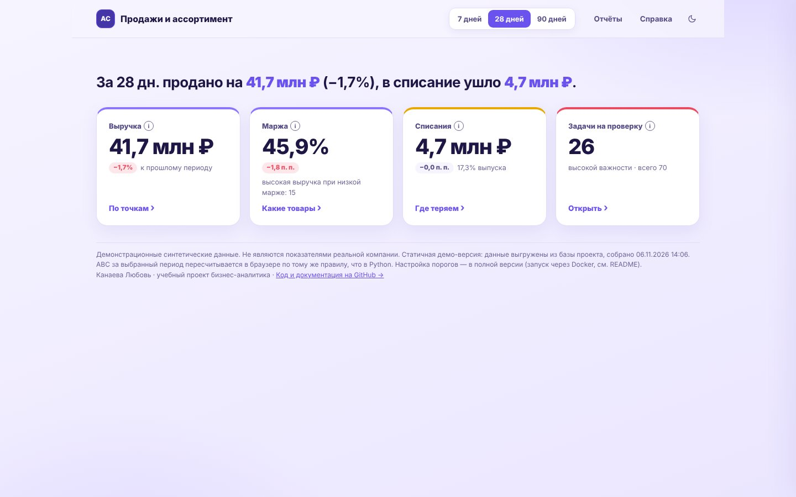
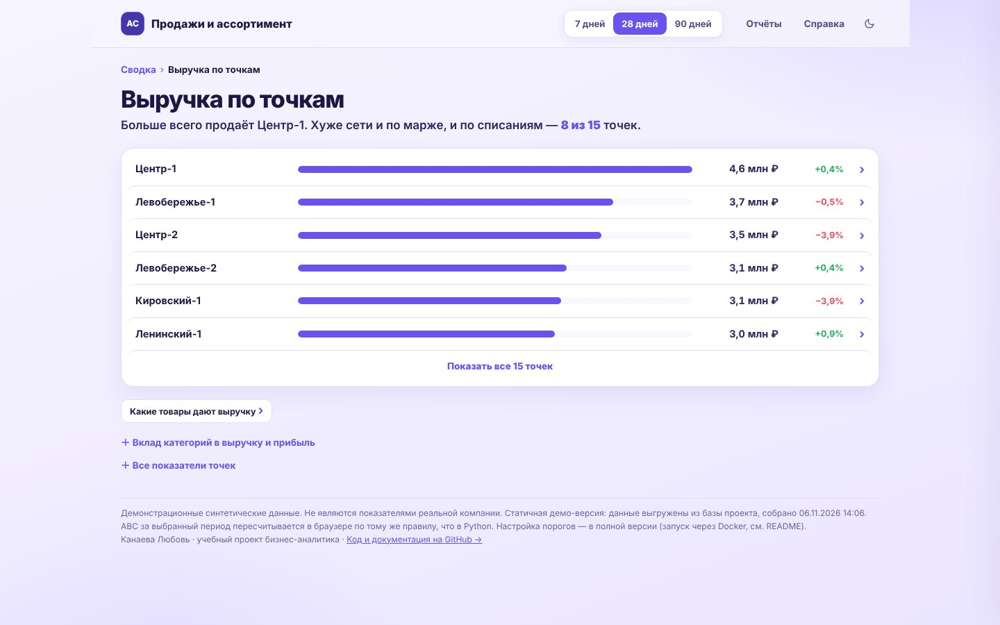
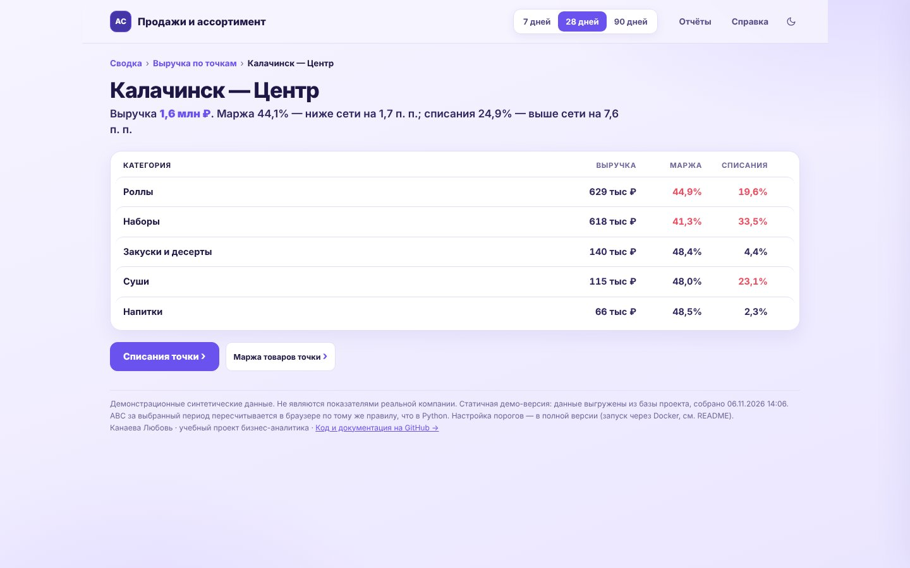
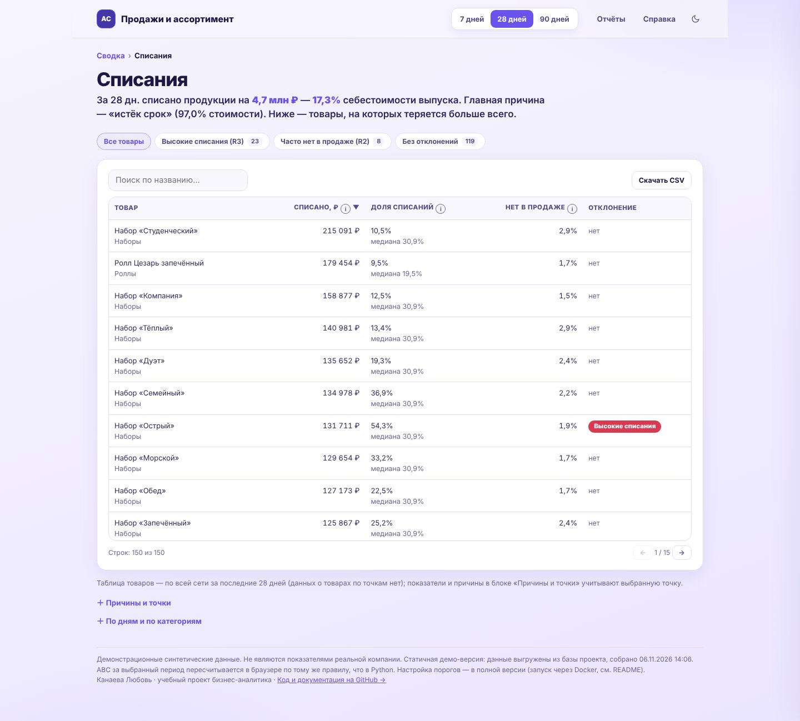
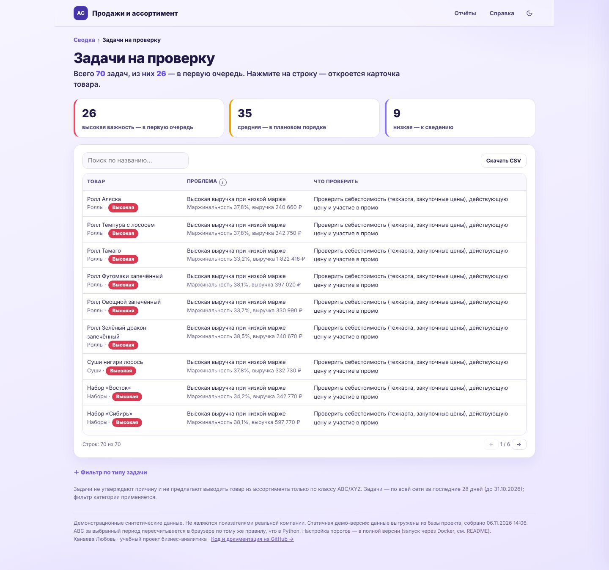
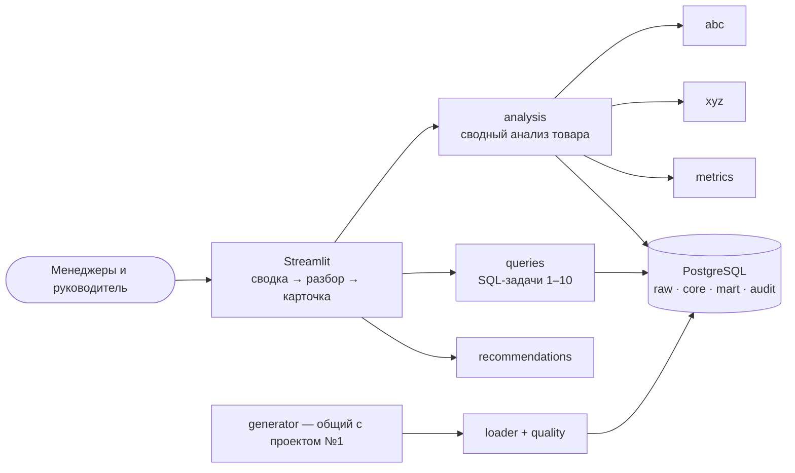

# Анализ продаж, ассортимента и списаний

[](https://github.com/lubancho/assortment-writeoff-analytics/actions/workflows/ci.yml)

Аналитическая система для сети точек формата «суши-маркет»: объединяет продажи, себестоимость, остатки и списания, делит ассортимент по вкладу (ABC) и стабильности спроса (XYZ) и формирует управленческие рекомендации — с основанием в данных и честными ограничениями.

**[Открыть интерактивную демо-версию →](https://lubancho.github.io/assortment-writeoff-analytics/)** — дашборд в браузере, без установки. **Путь вглубь вместо меню:** сводка из четырёх плиток (выручка, маржа, списания, задачи) → разбор показателя (например, выручка по точкам) → конкретная точка → её списания и маржа. Вверху — «хлебные крошки», отчёты и методика — по ссылкам в верхней строке. Данные выгружены из базы проекта; ABC за выбранный период пересчитывается в браузере, а за период по умолчанию сверяется с расчётом Python (все 300 классов совпадают). Настройка порогов и правил — только в полной версии (раздел «Запуск»).

> **Все данные синтетические.** Они созданы генератором с фиксированным seed и не являются показателями какой-либо реальной компании. Названия точек и товаров вымышлены. Проект учебно-практический и не связан с инфраструктурой какой-либо компании.



## 1. Бизнес-проблема

Свежая продукция живёт один день: приготовили мало — товар закончился и продажи потеряны, много — растут списания. Одновременно нужно понимать, какие позиции действительно зарабатывают, у каких спрос ровный, а какие только занимают место в меню.

## 2. Цели

Видеть вклад товаров, категорий и точек в выручку и прибыль; отличать стабильный спрос от нестабильного, не путая отсутствие товара с отсутствием спроса; видеть стоимость и причины списаний; получать рекомендации, что проверить, — без автоматических решений об ассортименте.

## 3. Функциональность

Меню нет: пользователь идёт от сводки вглубь, вверху каждой страницы — «хлебные крошки». На странице — одна фраза-вывод и один главный блок, остальное — в свёрнутых блоках.

| Уровень | Экран | Что показывает |
|---|---|---|
| 1 | **Сводка** | Одна фраза о продажах и потерях и 4 плитки-«двери»: выручка, маржа, списания, задачи на проверку |
| 2 | **Выручка по точкам** | Рейтинг точек с изменением к прошлому периоду; вклад категорий — по запросу; переход в «Ассортимент» |
| 3 | **Точка** | Категории: выручка, маржа, доля списаний к сети → «Списания точки», «Маржа товаров точки» |
| 2 | **Ассортимент** | Понятные группы товаров и таблица; профессиональный режим ABC/XYZ — по запросу |
| 2 | **Списания** | Сколько потеряно и главная причина; товары с наибольшими потерями (доля к медиане категории); причины и точки — по запросу |
| 2 | **Маржа товаров** | Товары с маржой ниже сети на 5+ п. п.: что проверить и возможные факторы (гипотезы) |
| 2 | **Задачи на проверку** | Уровни важности и список задач по 5 правилам; карточка товара — по клику |
| — | **Отчёты** и **Справка** | Каталог 10 отчётов (SQL свёрнут); формулы, ABC/XYZ, правила, качество данных, ограничения |

Общие фильтры периода и точек — в верхней строке страницы, действуют на всех страницах.

| Сводка → Выручка по точкам | Точка: категории |
|---|---|
|  |  |
| **Списания** | **Задачи на проверку** |
|  |  |

Полная версия на Streamlit устроена так же: [сводка](docs/ux/v4/streamlit_home.jpg), [выручка по точкам](docs/ux/v4/streamlit_sales.jpg), [списания](docs/ux/v4/streamlit_stock.jpg), [маржа товаров](docs/ux/v4/streamlit_profitability.jpg), [задачи](docs/ux/v4/streamlit_recommendations.jpg), [ассортимент](docs/ux/v4/streamlit_assortment.jpg), [отчёты](docs/ux/v4/streamlit_reports.jpg), [справка](docs/ux/v4/streamlit_methodology.jpg); демо на телефоне — [390 px](docs/ux/v4/mobile.jpg).

Интерфейс прошёл UX-ревью, редизайн и две корректировки по читаемости (разделы 9–11; текущая структура — «путь вглубь»: сводка → разбор → карточка): аудит, дизайн-система, что скрыто и перенесено, скриншоты до и после — [docs/09_ux_redesign.md](docs/09_ux_redesign.md).

## 4. Архитектура



Все экраны берут данные из одного модуля `analysis` — поэтому цифры на разных экранах совпадают. Диаграммы (контекстная, компонентная, бизнес-процесс, последовательность) и решения — [docs/05_architecture.md](docs/05_architecture.md).

## 5. Модель данных

Совместима с проектом «Контроль цен и маржинальности» (репозиторий `price-margin-control`): одинаковые таблицы `core`, генератор и идентификаторы точек и товаров. Дополнительно — представления `mart` со стоимостью списаний и запасов на дату. ER-диаграмма — [docs/03_data_model.md](docs/03_data_model.md).

## 6. Технологии

Python 3.12 · PostgreSQL 16 · psycopg 3 · Pandas · NumPy · Decimal/NUMERIC · Streamlit · Plotly · openpyxl · Pytest · Ruff · uv · Docker Compose · GitHub Actions · Mermaid.

## 7. Структура проекта

```
├── app/                    веб-интерфейс: main.py, views/, components/
├── src/asa/
│   ├── sql/                10 SQL-задач с документацией в шапке
│   ├── generator/          общий с проектом №1
│   └── analysis, abc, xyz, metrics, recommendations, queries, repository, loader, quality, export
├── migrations/             SQL-миграции 001–004
├── tests/                  unit/ integration/ ui/
├── docs/                   документация, скриншоты, результаты тестов
└── compose.yaml, Dockerfile, .env.example, .github/workflows/ci.yml
```

## 8. Запуск

```bash
cp .env.example .env
docker compose up --build
# открыть http://localhost:8502
```

Без Docker (нужны PostgreSQL 16 и [uv](https://docs.astral.sh/uv/)):

```bash
cp .env.example .env            # поправьте DATABASE_URL
uv sync
uv run asa init-demo            # миграции + демо-данные
uv run streamlit run app/main.py
```

SQL-задачу можно выполнить из консоли: `uv run asa sql 8 --from 2026-10-04 --to 2026-10-31`.

**Демо-версия для GitHub Pages** собирается из базы с загруженными данными:

```bash
uv run asa init-demo
uv run python scripts/build_static_demo.py --out site
```

Папка `site/` публикуется в ветку `gh-pages`. Исходники страницы — `scripts/web/` (HTML, CSS, JS, графики [ECharts](https://echarts.apache.org) 5.6.0, лицензия Apache-2.0 — `scripts/web/vendor/`).

## 9. Примеры расчётов (период 04.10–31.10.2026)

**ABC по выручке:** 50 товаров класса A дают 80,3% выручки, 46 товаров B — 14,8%, 54 товара C — 4,9%. У 9 товаров класс по выручке и по прибыли различается — поэтому классификации не смешиваются.

**Граница класса:** доли 50, 25, 10, 8% → третий товар начинается с накопленных 75% (меньше 80%) и остаётся в A, хотя с ним накопленная доля 85%.

**XYZ:** по 11 полным неделям (окно 12 недель до конца периода): X — 61 товар, Y — 77, Z — 12. Недели, когда товар был доступен меньше чем в 80% рабочих точко-дней, исключаются.

**Найденное отклонение:** «Ролл Унаги» — списано на 12 133 ₽, это 54,3% себестоимости выпуска при медиане категории «Роллы» 19,5%.

**Рекомендация (R2):** «Ролл Радуга» — стабильный спрос (класс X), но товара не было в продаже в 14 из 413 рабочих точко-дней (3,4% при цели не более 3%). Действие: проверить план производства и страховой запас. Ограничение: в дни отсутствия настоящий спрос неизвестен, нулевые продажи — не нулевой спрос.

Всего за период — 70 рекомендаций по 54 товарам: высокая важность 26, средняя 35, низкая 9. Методика — [docs/04_metrics_methodology.md](docs/04_metrics_methodology.md).

## 10. Примеры SQL

Все 10 задач с целью, таблицами, логикой соединения, детализацией и проверкой — [docs/07_sql_tasks.md](docs/07_sql_tasks.md). Фрагмент ABC-классификации — накопленная доля оконной функцией и правило границы:

```sql
SELECT product_id, value, share,
       sum(share) OVER (ORDER BY value DESC, product_id
                        ROWS BETWEEN UNBOUNDED PRECEDING AND CURRENT ROW) AS cum_share
FROM shares;
-- класс: накопленная доля ДО товара (cum_share − share) < 0,80 → A, < 0,95 → B, иначе C
```

Товары без продаж — с различием «не покупали» и «не было в продаже»:

```sql
CASE WHEN COALESCE(a.available_days, 0) = 0 THEN 'не было в продаже'
     ELSE 'был в продаже, но не покупали' END AS interpretation
```

## 11. Тестирование

88 автоматических тестов: формулы, ABC (граница, равенства, отрицательный вклад), XYZ (доступность, мало наблюдений, короткая история, тренд), метрики запасов и списаний, все 5 правил рекомендаций; интеграционные — выполнение и документация всех SQL-задач, сходимость итогов, совпадение ABC в SQL и Python, стоимость списаний в SQL и Python; экранные — 8 страниц с фильтром точек и без, совпадение числа на экране с SQL.

```bash
uv run pytest                     # нужен TEST_DATABASE_URL на базу с именем *_test (можно в .env)
docker compose run --rm app pytest
```

Фактический результат — [docs/test_results.txt](docs/test_results.txt); статус требований — [docs/08_implementation_report.md](docs/08_implementation_report.md).

## 12. Ограничения

- Данные синтетические; пороги правил подобраны под них и для реального бизнеса требуют согласования.
- ABC и XYZ считаются по сети в целом; фильтр точек на них не действует.
- Доля списаний свежей продукции в демо-данных (20–31%) выше типичной: модель выпуска упрощена.
- «Распродано к закрытию» для свежей продукции может означать и точное планирование, поэтому в рекомендации не входит.
- Нет авторизации и интеграции с учётными системами.
- Формат чисел в таблицах — по языку браузера.

## 13. Возможности развития

ABC/XYZ на уровне «точка × товар»; прогноз спроса с учётом дня недели и промо; оценка потерянных продаж в дни отсутствия; рекомендации по объёму выпуска; хранение истории рекомендаций и решений.

## 14. Роль автора

Учебно-практический проект бизнес-аналитика. Автор сформулировал бизнес-задачу, требования, методику метрик, правила рекомендаций и критерии приёмки, проверял результаты. Код, тесты и инфраструктура разработаны с помощью ИИ-ассистента по этим требованиям; проект используется автором для изучения SQL, Python и PostgreSQL и не является подтверждением коммерческого опыта разработки.

## Документация

[01 — паспорт и границы](docs/01_vision_and_scope.md) · [02 — требования](docs/02_requirements.md) · [03 — модель данных](docs/03_data_model.md) · [04 — методика](docs/04_metrics_methodology.md) · [05 — архитектура](docs/05_architecture.md) · [06 — макеты](docs/06_ui_mockups.md) · [07 — SQL-задачи](docs/07_sql_tasks.md) · [08 — отчёт о реализации](docs/08_implementation_report.md) · [09 — UX/UI-редизайн](docs/09_ux_redesign.md)
