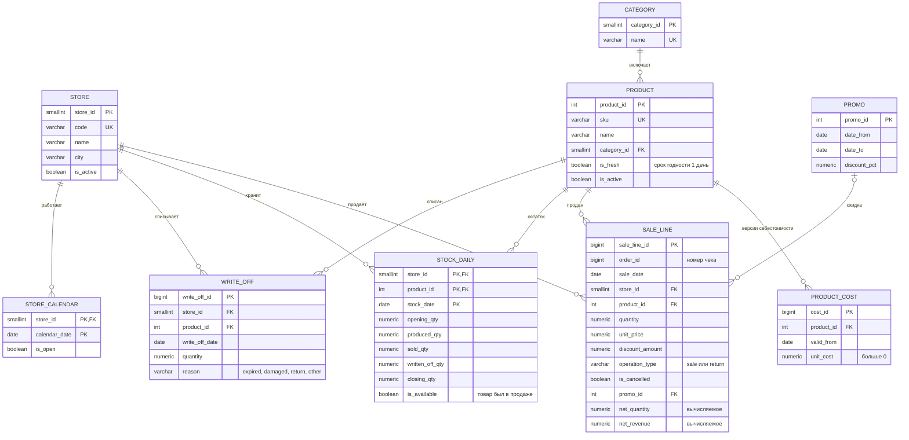

# 03. Модель данных

Модель **совместима с проектом №1**: схема `core` (справочники, продажи, цены, себестоимость, остатки, списания, календарь) и генератор данных одинаковы в обоих репозиториях, идентификаторы `store_id`, `product_id`, `category_id`, `sku` совпадают. Полный словарь основных таблиц — в документе 03 проекта «Контроль цен и маржинальности». Здесь — то, что важно для анализа ассортимента и списаний.

## 1. Слои

| Схема | Назначение |
|---|---|
| `raw` | Продажи, цены, себестоимость «как пришли», включая ошибочные строки |
| `core` | Проверенные данные с ограничениями целостности |
| `mart` | Аналитические представления проекта №2 |
| `audit` | Журнал событий (только дополняется), проблемы качества, пакеты загрузки, миграции |

## 2. ER-диаграмма

**Как читать:** `||--o{` — «один ко многим»; `|o--o{` — связь необязательна (продажа может быть без акции).

## 3. Ключевые ограничения

| Таблица | Ограничение | Зачем |
|---|---|---|
| `sale_line` | `net_revenue`, `net_quantity` — вычисляемые поля со знаком операции | Правило знака нельзя «забыть» в запросе |
| `sale_line` | `source_row_hash UNIQUE` | Повторная загрузка той же строки невозможна |
| `sale_line` | `discount_amount ≤ quantity × unit_price` | Скидка не больше суммы |
| `stock_daily` | `closing = opening + produced − sold − written_off`, все ≥ 0 | Баланс остатков |
| `product_cost` | `unit_cost > 0`, `UNIQUE (product_id, valid_from)` | Ошибочная себестоимость остаётся в `raw` и журнале проблем |
| `write_off` | `quantity > 0`, причина из списка | — |

## 4. Представления `mart`

| Представление | Что даёт |
|---|---|
| `core.v_sale_fact` | Строка продажи + себестоимость на дату продажи (`net_cogs`) |
| `mart.v_write_off_fact` | Списание + себестоимость на дату списания (`cost_amount`) |
| `mart.v_stock_fact` | Остатки + себестоимость, стоимость доступного запаса, признак работы точки и «распродано» |

«Распродано» = товар был в продаже, продажи были, а к закрытию ничего не осталось (с учётом возвратов, которые возвращаются на полку и сразу списываются).

## 5. Демонстрационные данные

Генератор одинаковый в обоих проектах (seed 20261105). Продажи, цены, себестоимость, акции и манифест из 93 заложенных ошибок **побайтно совпадают** с проектом №1 (проверено сравнением DataFrame).

При разработке проекта №2 модель выпуска свежей продукции изменена: «продажи + небольшой случайный запас» вместо округления вверх с запасом до 35% — исходная модель давала около 30% себестоимости выпуска в списаниях, что неправдоподобно. Изменение затрагивает только остатки и списания и перенесено в проект №1, чтобы генераторы оставались одинаковыми.

| Объект | Значение |
|---|---|
| Строк продаж (`core`) | 316 140 |
| Строк остатков | 202 500 |
| Строк списаний | 46 734 |
| Доля списаний за 04.10–31.10.2026 | 17,3% (свежая продукция 20–31%, напитки и закуски 2–3%) |
