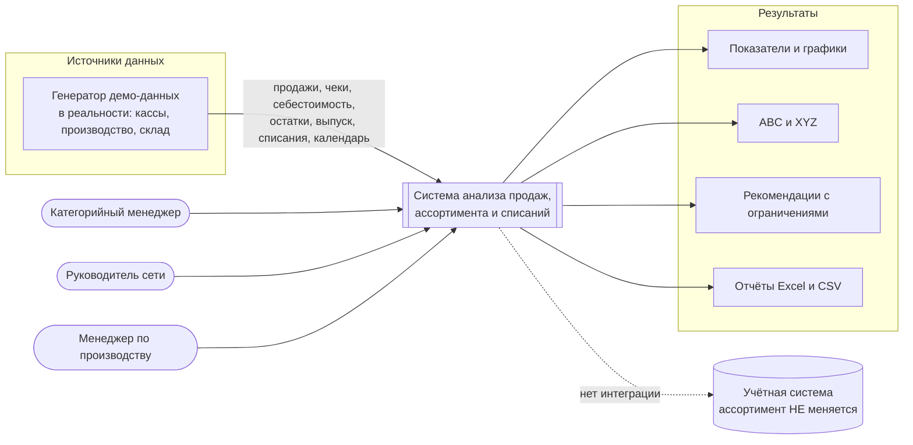
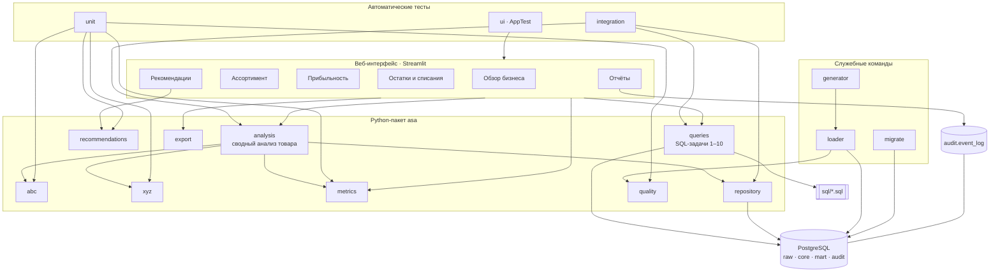
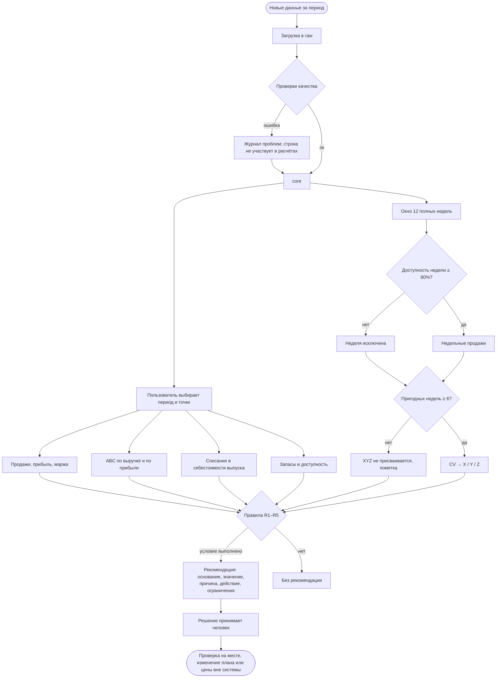
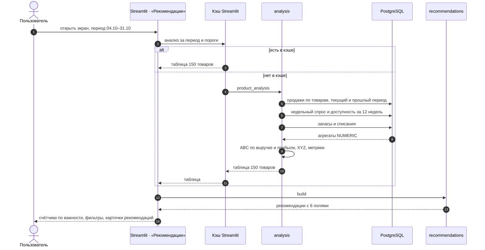

# 05. Архитектура приложения

## 1. Архитектурные решения

| ID | Решение | Почему |
|---|---|---|
| ADR-01 | Общая модель данных и генератор с проектом №1 | Требование ТЗ §20; один демо-набор, одинаковые идентификаторы |
| ADR-02 | Суммы — в SQL (`NUMERIC`), классификации и правила — в Python | SQL быстро и точно агрегирует 316 тыс. строк; ABC/XYZ и правила проще читать и тестировать в Python |
| ADR-03 | ABC реализован дважды: SQL-задача 8 и `asa.abc` | ТЗ требует SQL-реализацию; совпадение двух независимых реализаций — сильная проверка |
| ADR-04 | Один модуль `analysis` собирает все показатели товара | Экраны и отчёты берут данные из одного места — цифры совпадают |
| ADR-05 | Рекомендации считаются «на лету», не хранятся | Воспроизводимы из данных и порогов; не нужен механизм устаревания |
| ADR-06 | SQL-задачи — отдельные `.sql` файлы с документацией в шапке | Документ 07 генерируется из файлов; описание не расходится с кодом |
| ADR-07 | XYZ — фиксированное окно 12 недель | При коротком выбранном периоде наблюдений не хватает |
| ADR-08 | psycopg 3 без ORM, свои SQL-миграции, uv, openpyxl | Как в проекте №1 (единый стек) |

## 2. Контекстная диаграмма



**Простыми словами:** данные о продажах, производстве и списаниях попадают в систему; три типа пользователей смотрят показатели и рекомендации и выгружают отчёты. Система ничего не меняет в учётной системе.

## 3. Компонентная архитектура



**Простыми словами:** экраны берут данные из модуля `analysis`, который собирает всё о товаре (продажи, классы, запасы, списания) в одну таблицу. SQL-задачи живут в отдельных файлах. Тесты проверяют и формулы по отдельности, и совпадение цифр между SQL, Python и экраном.

## 4. Бизнес-процесс «от данных до рекомендации»



## 5. Последовательность: открытие экрана «Рекомендации»



**Простыми словами:** тяжёлые запросы выполняются один раз для пары «период + пороги» и кэшируются; при переходе между экранами тот же анализ берётся из кэша, поэтому цифры одинаковые и экран открывается быстро.

## 6. Структура репозитория

```
├── app/                       main.py, views/ (6 экранов), components/ui.py
├── src/asa/
│   ├── sql/                   01…10 — SQL-задачи с документацией
│   ├── generator/             общий с проектом №1
│   ├── analysis.py abc.py xyz.py metrics.py recommendations.py
│   ├── queries.py repository.py loader.py quality.py export.py migrate.py cli.py
├── migrations/                001–004
├── tests/                     unit/ integration/ ui/
├── docs/
├── compose.yaml Dockerfile .env.example .github/workflows/ci.yml
```

## 7. Инфраструктура

Как в проекте №1: `db` (PostgreSQL 16, проверка `pg_isready`) → `init` (`asa init-demo`: миграции и демо-данные) → `app` (Streamlit, проверка `/_stcore/health`). Порты по умолчанию 5434 и 8502, чтобы оба проекта можно было запустить одновременно. CI: Ruff, Pytest с сервисом PostgreSQL, запуск через Docker Compose.
